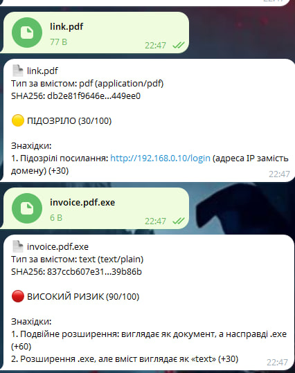
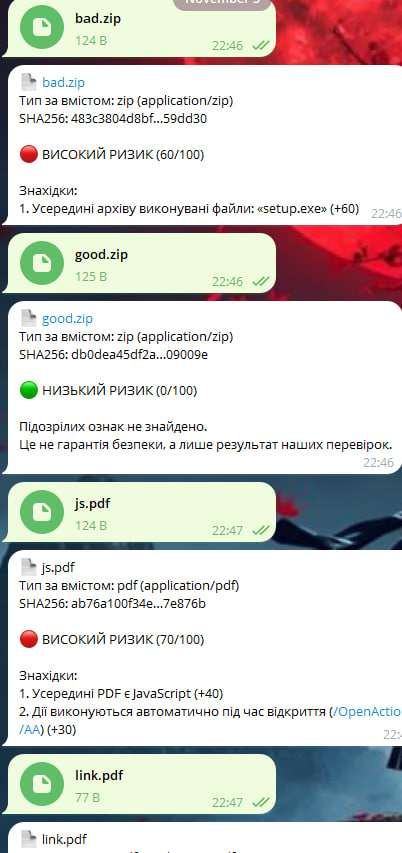

# filetrust — Telegram-бот для безпечної перевірки файлів і посилань без їх запуску

**filetrust** — це бот-помічник для особистих і групових чатів Telegram, який перевіряє вкладені файли та URL-посилання на ознаки фішингу, маскування та шкідливого вмісту **до того, як ви їх відкриєте**.

Файл **ніколи не запускається** у програмах чи операційній системі: бот читає його виключно як потік байтів в ізольованому дочірньому процесі, розбирає внутрішню структуру документа або архіву й пояснює зрозумілою мовою, чи безпечно відкривати вкладення.

---

## Навіщо потрібен цей бот (простими словами)

Зловмисники в Telegram регулярно користуються тим, що звичайний користувач бачить лише іконку та назву файлу:
- надсилають вірус під виглядом документа (`invoice.pdf.exe` або зі спецсимволом перевертання тексту RTLO `U+202E`, коли `.exe` маскується під `.pdf`);
- ховають виконуваний файл усередині звичайного `.zip` або `.7z` архіву;
- прикріплюють прихований JavaScript або автозапуск команд у `.pdf`, макроси у `.docm`/`.xlsm` або HTML-сторінки, які непомітно збирають шкідливий файл прямо у браузері (*HTML smuggling*);
- кидають фішингові посилання з підміною літер у домені (`xn--` / punycode) або прямими IP-адресами.

Завантажувати робочі чи навчальні документи у публічні онлайн-пісочниці небезпечно для конфіденційності, а перевірка лише за розширенням пропускає більше половини таких атак. **filetrust** вирішує обидві проблеми: аналізує файл локально на сервері бота за ~11 мілісекунд, не передає дані стороннім сервісам і видає аргументований вердикт.

---

## Приклади роботи в Telegram

| Перевірка підозрілого посилання та виконуваного файлу | Аналіз архіву з прихованим PDF та ризиками |
| :---: | :---: |
|  |  |

---

## Як влаштована система під капотом

Кожне повідомлення проходить через чотириступеневий захищений конвеєр:

```text
Telegram (особисті чати / модерація груп через aiogram 3)
   │
   ├─► Текст із посиланням ─► analyzers/urlcheck.py (IDN/punycode, IP-хости, скорочувачі, TLD)
   │
   └─► Файл (до 20 МБ) ────► isolated.py (окремий процес worker.py, жорсткий таймаут 60 с)
                                │
                                ▼
                            detect.py (SHA-256 + реальний MIME за магічними байтами libmagic)
                                │
                                ▼
                           pipeline.py (базові перевірки common.py + спеціалізований парсер)
                                │
                                ▼
                      scoring/engine.py + explain.py + report.py
                      (ризик-бал 0–100, пояснення українською та детальний HTML-звіт)
Для цих видів (`kind`) виконуються лише базові перевірки (`common.py`: подвійне розширення, RTLO, невідповідність типу за вмістом), без розпакування чи внутрішнього парсингу:

- `exe`, `elf`, `lnk` — виконувані файли та ярлики одразу позначаються як файли високого ризику (`EXEC_FILE`, +60 балів);
- `rar`, `gz` — архіви визначаються за магічними байтами, але не розпаковуються.
